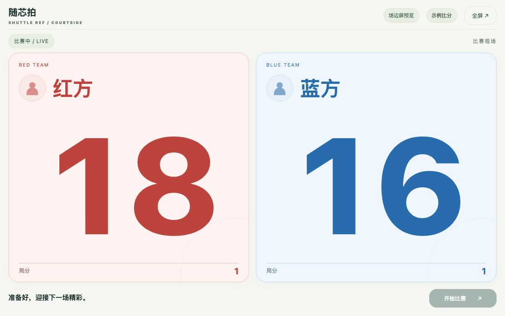
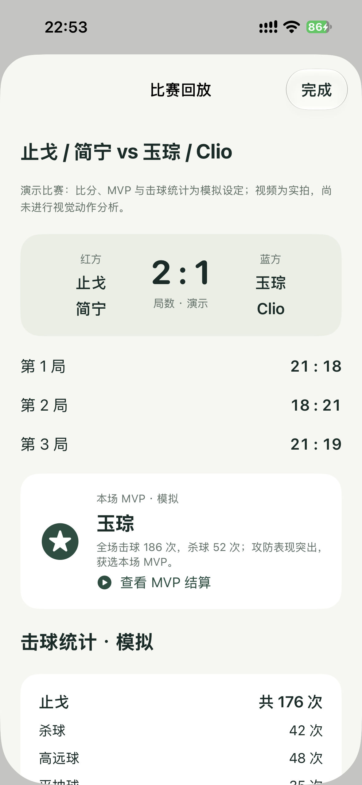
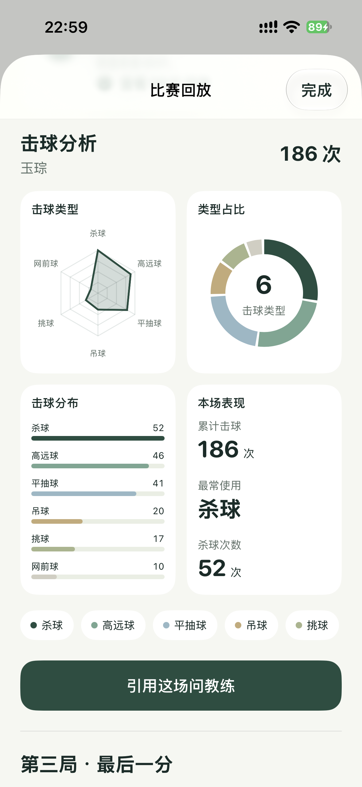

# 随芯拍 · RallyMate

**在球拍上记分，在手机上复盘。** 随芯拍是一套羽毛球智能计分与复盘套件，由拍底传感器、树莓派场边主机和手机 App 协同工作。

### 在场上

两位单打球员各用自己的拍底，双击加分，三连击撤销。树莓派按本场球员与球拍的对应关系确认得分，在场边屏幕上更新比分，双方也可以在手机上查看同一场比赛。使用手机蓝牙计分模式时，手机可以直接连接拍底。

*树莓派场边屏 HTML 预览 · 决胜局比分示例*

### 下场后

球员可以在 App 里查看比赛记录和视频回放。通过「引用这场问教练」，把比赛记录和已导入的视频观测带入对话，就录像中某一次变向或连续移动追问，回到对应的时间段复看。

| 比赛回放 · 逐局比分与 MVP | 击球分析 · 类型与分布 |
| :---: | :---: |
|  |  |

### 产品源码

- [iOS App](https://github.com/RallyMate-AI-Badminton-Kit/shuttleref-ios) · 比赛、拍底连接与复盘体验
- [Android App](https://github.com/RallyMate-AI-Badminton-Kit/shuttleref-android) · Android 客户端工程
- [树莓派计分核心](https://github.com/RallyMate-AI-Badminton-Kit/shuttleref-edge-core) · 比分规则、比赛状态与可运行测试
